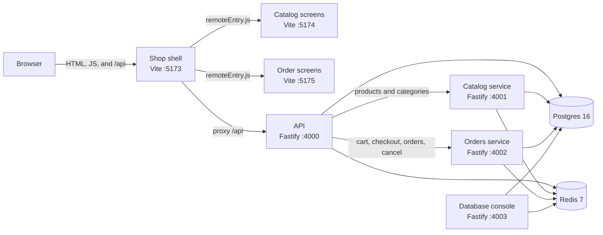
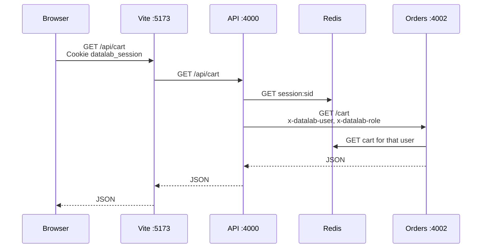
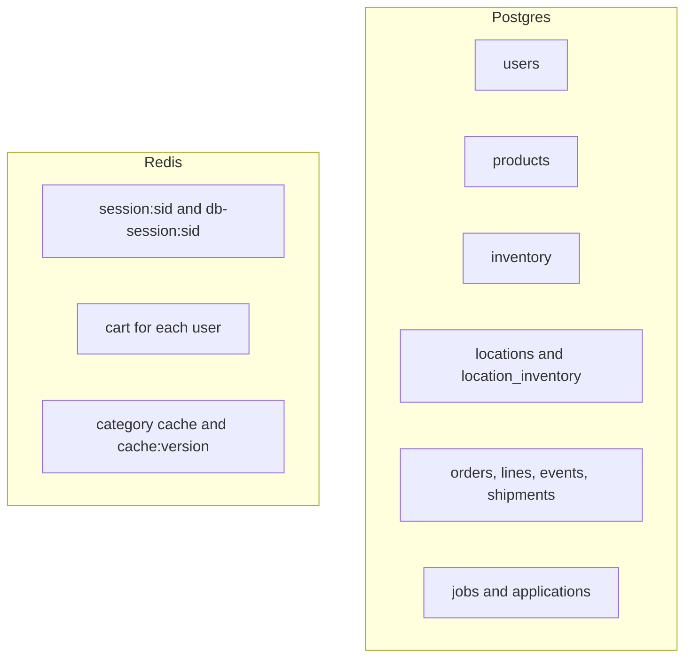

# How Marlow is put together

The browser only talks to the shop on port 5173. Vite serves the pages and forwards `/api` to the API. The API keeps the session and either answers the call or forwards it to the catalog or orders service. Postgres holds the shop data. Redis holds sessions, carts, and a short-lived category cache.

## Processes

The catalog and orders screens are separate Vite apps. Module federation loads their `remoteEntry.js` into the shell. React and React Router are shared, so those screens render inside the shell's page. Their `fetch("/api/...")` calls still go to port 5173, because that is the page origin. The proxies in the catalog and orders Vite configs matter when those apps are opened directly.

The database console is not behind the shop. Open it at `http://127.0.0.1:4003`. It signs in on its own and stores `datalab_db_session` in Redis.

## One API call

A cart read shows the whole path. The cookie never leaves the shop origin. Vite copies the request to the API, the API checks the session, and the orders service reads the cart.

`api()` in each frontend calls `fetch` with `credentials: "include"`. A JSON body is sent as `application/json`. A resume upload skips that helper and posts `FormData`, so the browser sets the multipart boundary.

Login writes `session:<sid>` in Redis and sets the `datalab_session` cookie. Later calls on the API read that record. Calls forwarded to catalog or orders also send `x-datalab-user` and `x-datalab-role`. The orders proxy adds `x-datalab-email`.

## Who answers `/api`

| Path | Answered by | Stored in |
| --- | --- | --- |
| `/api/login`, `/api/logout`, `/api/me` | API | Redis session |
| `/api/customers` | API | Postgres `users`, `orders` |
| `/api/products`, `/api/categories` | Catalog service, through the API | Postgres `products`. Category counts cached in Redis for 60 seconds |
| `/api/inventory` | API | Postgres `inventory` (warehouse) |
| `/api/locations` | API | Postgres `locations`, `location_inventory` |
| `/api/jobs`, `/api/applications` | API | Postgres `jobs`, `applications`. Resume files on disk under `server/uploads/resumes` |
| `/api/cart`, `/api/checkout` | Orders service, through the API | Cart in Redis. Checkout writes Postgres `orders` and clears the cart |
| `/api/orders`, `/api/orders/:number/cancel` | Orders service, through the API | Postgres `orders` |
| `/api/orders/:number/pick`, `ship`, `out-for-delivery`, `deliver`, `tracking`, `collect` | API | Postgres `orders`, `shipments`, `tracking_events` |

Checkout for a shipped order reserves warehouse `inventory`. Checkout for pickup copies the store address onto the order, charges no shipping, and decrements `location_inventory`.

## What each store is for

Placing or cancelling an order increments `cache:version`, which drops the cached category counts on the next read.
