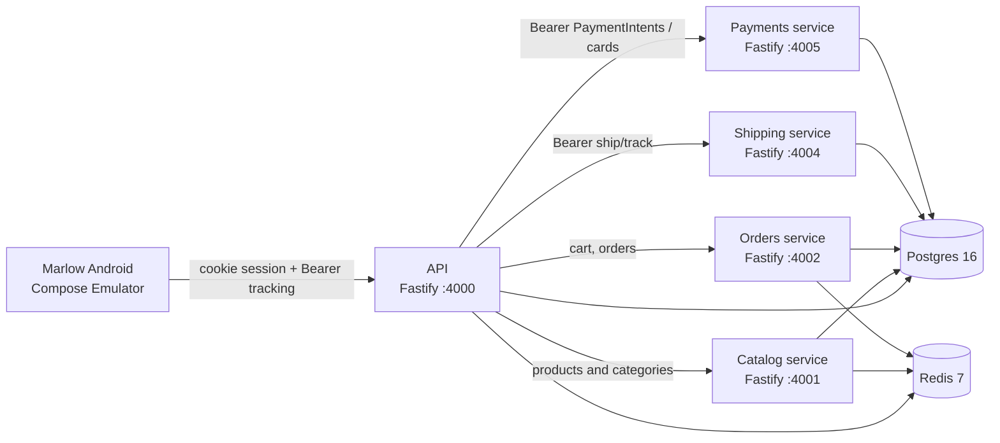
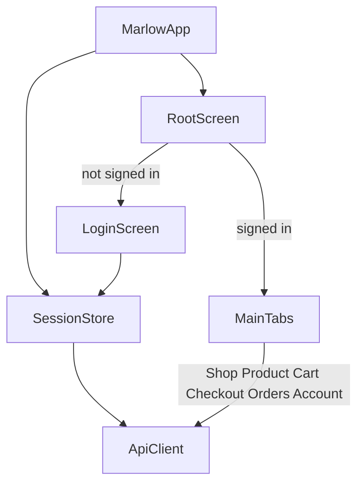

# How Marlow Android is put together

The Jetpack Compose app talks **directly** to the API on port 4000. It does not use the Vite shop shell (`:5173`). Auth is the same Redis-backed cookie session the web and iOS apps use: `datalab_session` via OkHttp `JavaNetCookieJar`.

Order tracking also uses **Bearer** tokens: after cookie login, `POST /api/shipping/access-token`, then `GET /api/tracking/:trackingNumber` with `Authorization: Bearer …`.

Customer v1 only: login, shop, product, cart, ship checkout, orders, account. Staff/admin stay on the web app. Broader platform layout is in the root [ARCHITECTURE.md](../../ARCHITECTURE.md). The iOS twin is [ios/Marlow/ARCHITECTURE.md](../../ios/Marlow/ARCHITECTURE.md).

## Processes

The emulator reaches the host at `http://10.0.2.2:4000` (`BuildConfig.API_BASE_URL`). Override with Gradle `-Pmarlow.apiBaseUrl=…`. Cleartext HTTP is allowed via `network_security_config.xml`.

## App layout

| Area     | Path                                      | Role                                              |
| -------- | ----------------------------------------- | ------------------------------------------------- |
| App      | `…/MarlowApp.kt`, `MainActivity.kt`       | Session + Compose entry                           |
| Session  | `SessionStore.kt`                         | Restore / sign-in / sign-out                      |
| API      | `api/ApiClient.kt`                        | OkHttp + kotlinx.serialization + cookies         |
| Models   | `model/Models.kt`                         | Match iOS / OpenAPI fixtures                      |
| UI       | `ui/{login,shop,product,cart,…}`          | Customer screens + `Modifier.a11y`                |
| Config   | `config/AppConfig.kt`                     | API base URL from BuildConfig                     |

## Accessibility + Appium

Controls use `Modifier.a11y("…")` (contentDescription + testTag) with the same ids as iOS / web (`login-email`, `shop-search`, `tab-account`, …). Root sets `testTagsAsResourceId = true`. Shared Appium specs live under [`appium/`](../../appium/); run with `npm run appium:android`.
