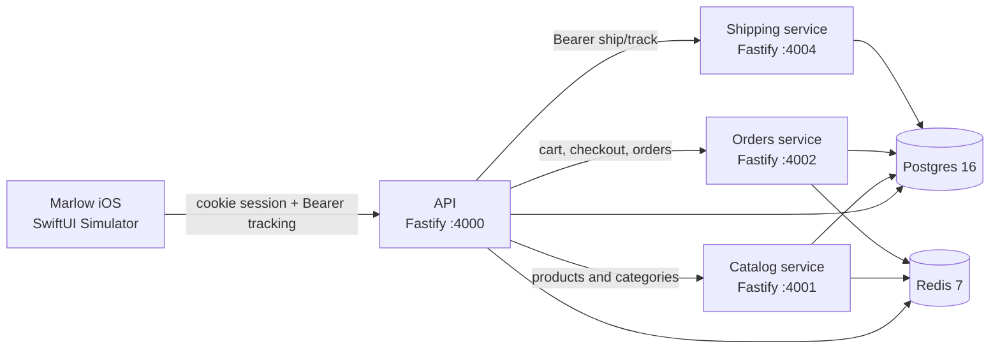
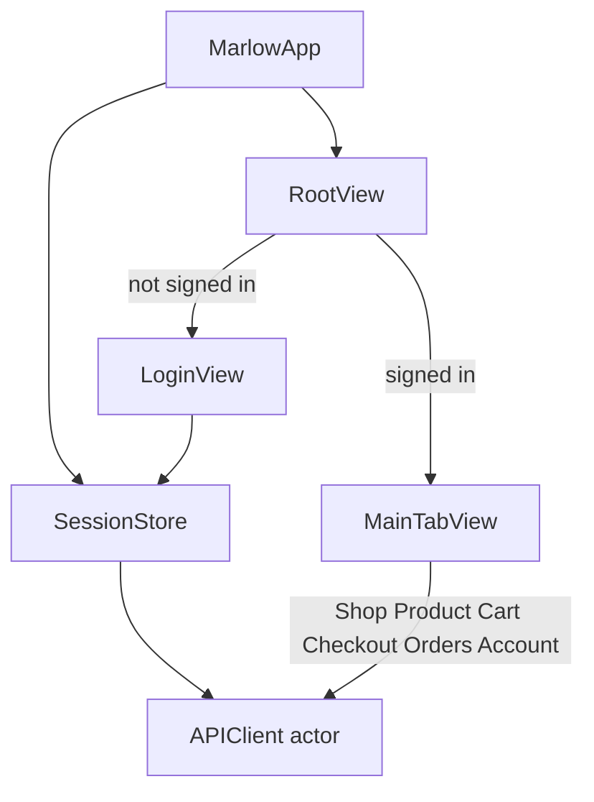
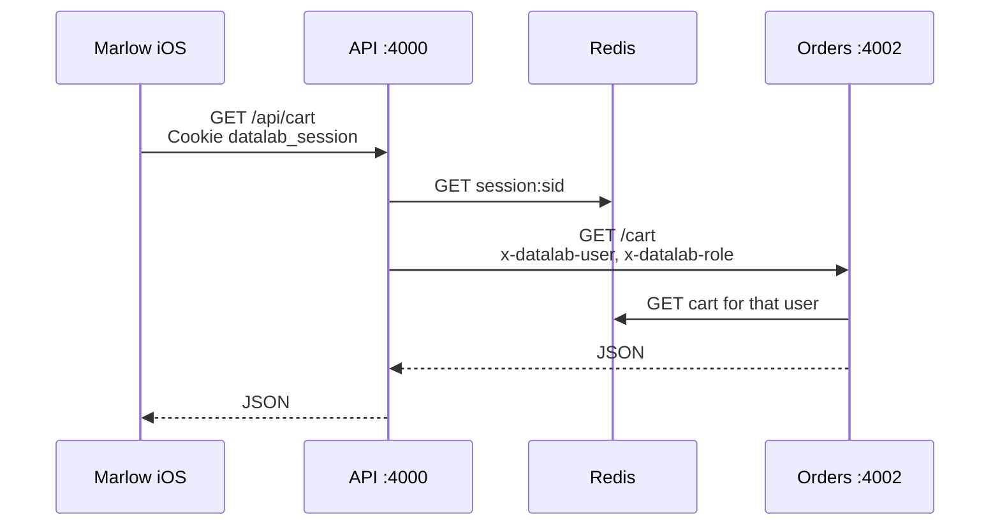

# How Marlow iOS is put together

The native SwiftUI app talks **directly** to the API on port 4000. It does not use the Vite shop shell (`:5173`). Auth is the same Redis-backed cookie session the web app uses: `datalab_session` stored in `HTTPCookieStorage` and sent on later `URLSession` calls.

Order tracking also uses **Bearer** tokens: after cookie login, `POST /api/shipping/access-token`, then `GET /api/tracking/:trackingNumber` with `Authorization: Bearer …` (same gateway paths as web). The shipping service on `:4004` never sees the session cookie.

Customer v1 only: login, shop, product, cart, ship checkout, orders, account. Staff/admin stay on the web app. Broader platform layout is in the root [ARCHITECTURE.md](../../ARCHITECTURE.md).

## Processes

Simulator reaches the host at `http://127.0.0.1:4000` (`AppConfig.apiBaseURL`). A physical device needs the Mac’s LAN IP via `MARLOW_API_BASE`. `Info.plist` allows local cleartext HTTP (`NSAllowsLocalNetworking`).

## App layout

| Area     | Path                            | Role                                                       |
| -------- | ------------------------------- | ---------------------------------------------------------- |
| Entry    | `Marlow/App/MarlowApp.swift`    | `@main`, owns `SessionStore`, restores `/api/me` on launch |
| Session  | `Marlow/App/SessionStore.swift` | `@Observable` signed-in user; login / logout / restore     |
| Root     | `Marlow/App/RootView.swift`     | Loading → login or tab shell                               |
| API      | `Marlow/API/APIClient.swift`    | `URLSession` JSON client + cookie jar                      |
| Models   | `Marlow/Models/Models.swift`    | Codable types aligned with OpenAPI / `fixtures/models/`    |
| Config   | `Marlow/Config/AppConfig.swift` | API base URL                                               |
| Features | `Marlow/Features/*`             | One folder per screen                                      |

Tabs: Shop, Cart, Orders, Account. Product and Checkout push on the Shop/Cart stacks.

## One API call

A cart read from the phone (or Simulator) skips Vite. The cookie lives on the API host.

`APIClient` encodes JSON bodies as `application/json`, decodes with `JSONDecoder`, and maps non-2xx bodies to `APIError` using `{ "error": "..." }` when present.

Login `POST /api/login` sets `datalab_session`. Logout clears the Redis session and local cookies. Launch calls `GET /api/me`; 401 means show login.

## Screens and endpoints

| Screen          | Primary API                                     |
| --------------- | ----------------------------------------------- |
| Login           | `POST /api/login`                               |
| Shop            | `GET /api/products`, search via `q`             |
| Product         | `GET /api/products/:sku`, `PUT /api/cart/items` |
| Cart            | `GET /api/cart`, `DELETE /api/cart/items/:sku`  |
| Checkout (ship) | `POST /api/checkout`                            |
| Orders          | `GET /api/orders`, `GET /api/orders/:number`    |
| Account         | `GET /api/me`, `POST /api/logout`               |

## Testing

| Layer                            | Where                                              | How to run                                       |
| -------------------------------- | -------------------------------------------------- | ------------------------------------------------ |
| HTTP contracts (shared with web) | `cypress/tests/api`, `playwright/api`, `fixtures/` | `npm run cypress:api` / `npm run playwright:api` |
| Simulator UI                     | `appium/` (WebDriverIO + XCUITest)                 | `npm run appium:ios`                             |
| Skill / rule                     | `ios-ui-test-author`, `ios-ui-tests.mdc`           | See `.cursor/skills/` and `.cursor/rules/`       |

UI selectors use SwiftUI `.accessibilityIdentifier` values (for example `login-email`) exposed to Appium as `~login-email`. Prefer ids that match web `data-testid`s when the concept exists on both platforms.

## Out of scope (v1)

- Staff pick/ship/tracking, admin, careers, store maps
- Push, Apple Pay, App Store distribution
- Android
